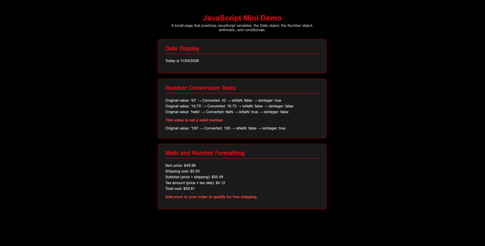

JavaScript Mini Demo — HW9

COMP 484

Live Site

GitHub Pages link: https://tadehcsun91.github.io/Comp484-HW9/

Screenshot

Built-in Objects and Methods Used:

Date object — to get the current date (getMonth(), getDate(), getFullYear())

Number() — to convert string values into numbers

Number.isNaN() — to check whether a converted value is not a valid number

Number.isInteger() — to check whether a converted value is a whole number

toFixed() — to format the math results to two decimal places

Extra Credit:

I added light styling with CSS so each section (Date Display, Number Conversion Tests, and Math and Number Formatting) appears as its own separate card/panel on the page.

Reflection:

The easiest part of this assignment was displaying the date, since the Date object methods (getMonth(), getDate(), getFullYear()) are straightforward once you remember that getMonth() is zero-based. The hardest part was keeping track of all the separate variables in the Number Conversion section without using arrays or loops — it made the code longer but helped me understand each conversion individually. Working with the Date object taught me that JavaScript months start at 0, so January is 0 and December is 11, which is an easy mistake to make. The Number object taught me the difference between a value just "looking like a number" as a string versus actually being validated with Number.isNaN() and Number.isInteger(). Displaying results in the browser showed me that updating textContent or innerHTML on an element by its id is how JavaScript actually changes what the user sees, rather than just logging to the console.